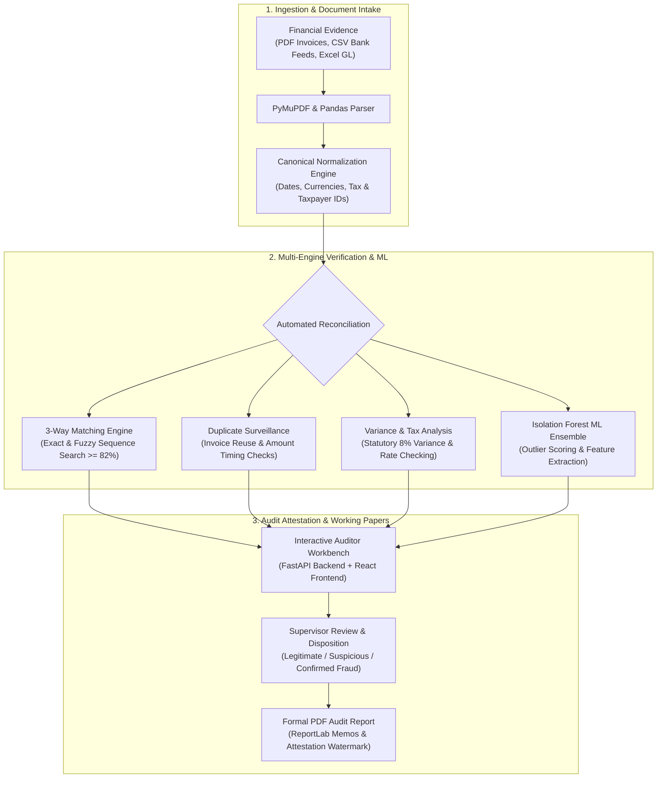
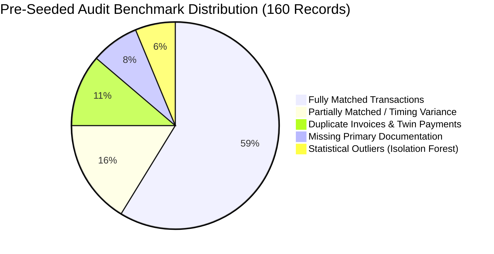
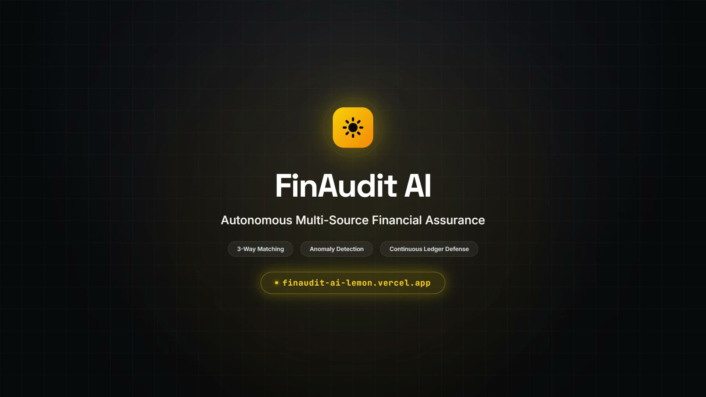

<div align="center">

# 🏛️ FinAudit AI

### Autonomous Multi-Ledger Assurance & Intelligent Financial Audit Assistant

[](https://finaudit-ai-lemon.vercel.app/)

[](https://fastapi.tiangolo.com)
[](https://reactjs.org/)
[](https://www.typescriptlang.org/)
[](https://tailwindcss.com/)
[](https://scikit-learn.org/)
[](LICENSE)
[](https://github.com/reignofoptimus/FinAudit-AI/stargazers)
[](https://github.com/reignofoptimus/FinAudit-AI/network/members)
[](https://github.com/reignofoptimus/FinAudit-AI/commits/main)

<br>

<a href="https://finaudit-ai-lemon.vercel.app/">
  
</a>

<p align="center">
  <em>Autonomous multi-ledger verification that detects duplicate payments, statutory tax variances, and statistical anomalies in milliseconds.</em>
</p>

<p align="center">
  <a href="https://finaudit-ai-lemon.vercel.app/"><strong>🚀 Launch Live Application</strong></a>
  &nbsp;&nbsp;•&nbsp;&nbsp;
  <a href="assets/demo.mp4"><strong>🎬 Watch Full HD 1080p Video (.mp4)</strong></a>
  &nbsp;&nbsp;•&nbsp;&nbsp;
  <a href="#-quick-start"><strong>⚡ Quick Start</strong></a>
</p>

</div>

---

## 📑 Table of Contents

- [✨ Overview](#-overview)
- [⚡ Key Capabilities](#-key-capabilities)
- [🏗️ System Architecture](#️-system-architecture)
- [📊 Benchmark & Findings](#-benchmark--findings)
- [🛠️ Tech Stack](#️-tech-stack)
- [📸 Application Walkthrough](#-application-walkthrough)
- [🚀 Quick Start](#-quick-start)
- [🔐 Demo Credentials](#-demo-credentials)
- [🧪 Document Upload & OCR Testing](#-document-upload--ocr-testing)
- [📁 Repository Structure](#-repository-structure)
- [📈 Repository Analytics](#-repository-analytics)
- [🗺️ Product Roadmap](#️-product-roadmap)
- [🤝 Contributing](#-contributing)
- [📄 License](#-license)

---

## ✨ Overview

**FinAudit AI** is an enterprise-grade financial assurance platform engineered to replace error-prone manual ledger audits with continuous, automated verification. Combining deterministic rule engines with unsupervised machine learning (**Isolation Forests**), the platform ingests heterogeneous accounting records (PDF invoices, CSV bank feeds, and Excel general ledgers), reconciles line items across ledgers, and surfaces anomalous transactions before monthly close.

> [!NOTE]  
> **Human-in-the-Loop Philosophy:** FinAudit AI functions as an assistive intelligence layer. All algorithmic classifications, anomaly scores, and twin-billing detections are presented to credentialed human auditors for supervisory review, disposition logging, and final attestation.

---

## ⚡ Key Capabilities

| Module | Core Functionality | Underlying Engine | Assurance Safeguard |
|---|---|---|---|
| **Executive Audit Dashboard** | Real-time surveillance of transactions, variance ratios, risk queues, and ledger velocity | Reactive aggregate queries with Recharts visualizer | High-risk items prioritized by materiality thresholds |
| **Document Intake & OCR** | Drag-and-drop ingestion of PDFs, CSVs, and Excel sheets (up to 25MB) | PyMuPDF (`fitz`) & Pandas with canonical schema normalization | Interactive in-browser table to verify & edit extracted OCR records |
| **3-Way Reconciliation** | Cross-source matching (Vendor Invoices vs General Ledger vs Bank Statements) | Exact matching (100%) & fuzzy sequence similarity (>= 82%) | Categorizes into Fully Matched, Partial, and Amount/Date Mismatches |
| **Duplicate Surveillance** | Identification of twin/triplet disbursements and reused invoice numbers | Multi-factor heuristics with configurable 30-day temporal windows | Explanatory flag reasons; never auto-purges suspect payments |
| **Variance & Tax Audit** | Statutory tax calculation validation and source-to-ledger discrepancies | Deterministic arithmetic engine testing against standard 8% tax rules | High/Medium/Low risk escalation with dedicated resolution memos |
| **Evidentiary Surveillance** | Flags disbursements or journal postings lacking primary evidence | Foreign key cross-reference check against uploaded document hashes | Auditors can link uploaded source PDFs directly to orphaned records |
| **ML Anomaly Detection** | Detects off-cycle payments, volume spikes, and statistical outliers | Scikit-Learn `IsolationForest` (vendor z-score, velocity, timing vectors) | 0–100 normalized risk score with natural-language reason explanations |
| **Vendor Risk Profiler** | Vendor risk scoring (`High`, `Medium`, `Low`) based on historical anomalies | Rolling concentration index & discrepancy frequency tracking | Historical audit trails to support vendor renegotiation or blacklisting |
| **Audit Report Studio** | Generation of institutional-grade, formal audit workpapers and findings | ReportLab PDF compilation with executive summary & audit memos | Watermarked with *"AI-Generated Audit Draft — Subject to Final Review"* |
| **Access Control (RBAC)** | Segregated authorization for Lead Audit Partners and Forensic Auditors | JWT bearer tokens with bcrypt password hashing | Complete immutable audit trail logging all user actions |

---

## 🏗️ System Architecture



> [!TIP]  
> The architecture strictly separates **deterministic calculations** (such as statutory tax rates, exact invoice balances, and reconciliation tolerances) from **probabilistic anomaly scoring** (Isolation Forest), guaranteeing zero arithmetic hallucination.

---

## 📊 Benchmark & Findings

The platform comes pre-seeded with **160 production-grade transactional records** across 12 vendors, purposefully engineered to evaluate reconciliation tolerances and anomaly discovery:



---

## 🛠️ Tech Stack

<div align="center">

| Layer | Badges | Technologies |
|---|---|---|
| **Frontend** | [](https://react.dev/) [](https://www.typescriptlang.org/) [](https://tailwindcss.com/) [](https://vitejs.dev/) | React 18, TypeScript, Tailwind CSS, Recharts, Lucide Icons, Vite |
| **Backend** | [](https://python.org) [](https://fastapi.tiangolo.com) [](https://docs.pydantic.dev/) [](https://www.sqlalchemy.org/) | Python 3.12, FastAPI, Uvicorn, SQLAlchemy ORM, Pydantic v2 |
| **Data & ML** | [](https://scikit-learn.org/) [](https://numpy.org/) [](https://pandas.pydata.org/) | Scikit-Learn (Isolation Forest), NumPy, Pandas |
| **Document Engine** | [](https://pymupdf.readthedocs.io/) [](https://openpyxl.readthedocs.io/) [](https://www.reportlab.com/) | PyMuPDF (`fitz`), PyPDF, OpenPyXL, ReportLab PDF Engine |
| **Security & Auth** | [](https://jwt.io/) [](https://github.com/pyca/bcrypt) [](https://oauth.net/2/) | Python-Jose (JWT), Bcrypt Password Hashing, OAuth2 Bearer Tokens |

</div>

---

## 📸 Application Walkthrough

| Module | Interface Preview | Description |
|---|---|---|
| **Executive Dashboard** |  | Real-time surveillance of transactions, variance ratios, risk queues, and ledger velocity |
| **OCR Document Parser** |  | Drag-and-drop invoice and ledger ingestion with in-browser editable extraction tables |
| **Reconciliation Workbench** |  | Side-by-side ledger comparisons with one-click auditor approval and variance memos |

---

## 🚀 Quick Start

### 1. Fast Launch (Windows)

Launch the entire ecosystem (both FastAPI backend and React frontend) with one command:

```powershell
.\start_all.bat
```

* **Frontend Application:** `http://127.0.0.1:5173`
* **Backend REST API:** `http://127.0.0.1:8000`
* **Interactive OpenAPI Swagger Docs:** `http://127.0.0.1:8000/docs`

---

<details>
<summary><strong>🔧 Manual Installation & Step-by-Step Setup (Click to expand)</strong></summary>

<br>

#### Step 1: Clone the Repository
```bash
git clone https://github.com/reignofoptimus/FinAudit-AI.git
cd FinAudit-AI
```

#### Step 2: Configure & Start Backend
```bash
cd backend
python -m venv venv

# Windows
.\venv\Scripts\activate

# Linux/macOS
source venv/bin/activate

pip install -r requirements.txt
python run.py
```

#### Step 3: Configure & Start Frontend
Open a new terminal window:
```bash
cd frontend
npm install
npm run dev -- --host 127.0.0.1 --port 5173
```

</details>

---

## 🔐 Demo Credentials

The database is pre-configured with two role-based auditor profiles:

| Role | Email | Password | Access Level |
|---|---|---|---|
| **Lead Audit Partner** | `admin@finaudit.ai` | `AdminPass123!` | Full administrative access, threshold configuration, final report sign-off |
| **Forensic Auditor** | `auditor@finaudit.ai` | `AuditorPass123!` | Transaction investigation, OCR inspection, variance note recording |

> [!TIP]  
> Both test accounts can be logged into with a **single click** directly from the [live login page](https://finaudit-ai-lemon.vercel.app/).

---

## 🧪 Document Upload & OCR Testing

FinAudit AI includes pre-formatted financial evidence files to test the OCR engine:

1. In the top navigation bar, click **Test Sample Documents**.
2. Download any of the sample files:
   - `sample_invoice_cloudscale.pdf`: Standard vendor invoice with statutory line items
   - `sample_bank_statement_q4.csv`: Bank debit and credit settlement records
   - `sample_general_ledger.xlsx`: General ledger accounting journal entries
3. Navigate to **Documents**, select the document category, and drop the downloaded file into the upload zone.
4. Watch the real-time parsing sequence, inspect extracted rows, and modify any field before committing.

---

## 📁 Repository Structure

```
FinAudit-AI/
├── assets/                  # High-definition video demos, banners, and preview assets
│   ├── demo.gif             # Autoplaying product walkthrough
│   ├── demo.mp4             # Full HD 1080p demonstration video
│   └── demo-preview.jpg     # Application interface poster
├── backend/
│   ├── app/
│   │   ├── api/             # REST endpoints (auth, dashboard, docs, txs, matching, anomalies...)
│   │   ├── models/          # SQLAlchemy relational models (User, Document, Transaction...)
│   │   ├── schemas/         # Pydantic v2 validation contracts
│   │   ├── services/        # Extractor, matching, duplicate, anomaly, report generators
│   │   ├── sample_data/     # 160+ transaction generator & sample test documents
│   │   ├── config.py        # Risk parameters, thresholds, and environment config
│   │   ├── database.py      # SQLAlchemy session manager & engine setup
│   │   └── main.py          # FastAPI application factory & router mounting
│   ├── run.py               # Uvicorn server bootstrapper
│   └── requirements.txt     # Python dependency specifications
├── frontend/
│   ├── src/
│   │   ├── api/             # Axios typed API client
│   │   ├── components/      # UI components (Sidebar, Navbar, MetricCard, StatusBadge...)
│   │   ├── context/         # AuthContext & ToastContext providers
│   │   ├── pages/           # 11 modules: Dashboard, Documents, Matching, Anomalies...
│   │   ├── types/           # Domain TypeScript interfaces
│   │   └── App.tsx          # Application routing & permission gating
│   ├── tailwind.config.js   # Design system tokens & utility classes
│   └── package.json         # Node.js dependencies & scripts
├── start_all.bat            # Dual-stack automated launcher
├── start_backend.bat        # Dedicated backend runner
├── start_frontend.bat       # Dedicated frontend runner
├── LICENSE                  # MIT Open Source License
└── README.md                # Comprehensive technical documentation
```

---

## 📈 Repository Analytics

<div align="center">

<a href="https://github.com/reignofoptimus/FinAudit-AI">
  
</a>

<br><br>

[](https://star-history.com/#reignofoptimus/FinAudit-AI&Date)

</div>

---

## 🗺️ Product Roadmap

- [x] **Phase 1: Core Reconciliation & Anomaly Engine**
  - [x] Multi-tier 3-way transaction reconciliation (exact + sequence similarity)
  - [x] Isolation Forest ML model for statistical outlier isolation
  - [x] ReportLab multi-page executive PDF workpaper generator
- [x] **Phase 2: Live Deployment & Cloud Access**
  - [x] Production deployment on Vercel (`finaudit-ai-lemon.vercel.app`)
  - [x] Self-contained mock dataset and interactive one-click auditor sign-in
- [ ] **Phase 3: Production Database & Multi-Tenancy**
  - [ ] Alembic migration suite with managed PostgreSQL / Supabase adapter
  - [ ] Multi-tenant workspace partitioning for independent audit firms
- [ ] **Phase 4: Generative Audit Synthesis (Claude Ultra Integration)**
  - [ ] Multi-document semantic reconciliation using Claude Ultra long context
  - [ ] Automated natural-language audit memo drafting according to IFRS/GAAP standards
- [ ] **Phase 5: ERP & Accounting Integrations**
  - [ ] Native synchronization connectors for Xero, QuickBooks Online, and NetSuite

---

## 🤝 Contributing

Contributions are welcome from developers, auditors, and data scientists!

1. **Fork the Repository**
2. **Create a Feature Branch:** `git checkout -b feature/enhanced-matching-engine`
3. **Commit Your Changes:** `git commit -m "feat: add Levenshtein distance fallback to vendor matching"`
4. **Push to the Branch:** `git push origin feature/enhanced-matching-engine`
5. **Open a Pull Request:** Describe the enhancements and ensure existing tests pass.

---

## 📄 License

Distributed under the **MIT License**. See [`LICENSE`](LICENSE) for more information.

<div align="center">
  <sub>Engineered by <a href="https://github.com/reignofoptimus">Nirmal Madhu</a> · Open-source assurance for institutional finance</sub>
</div>
